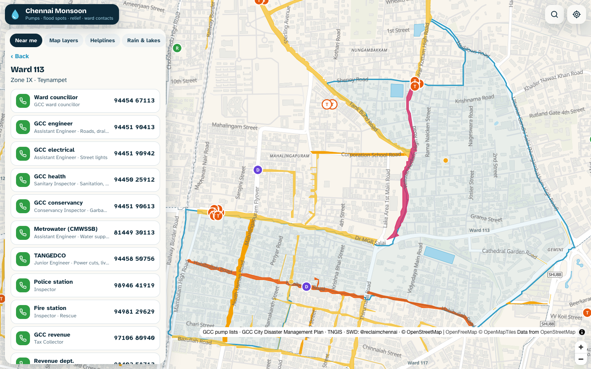
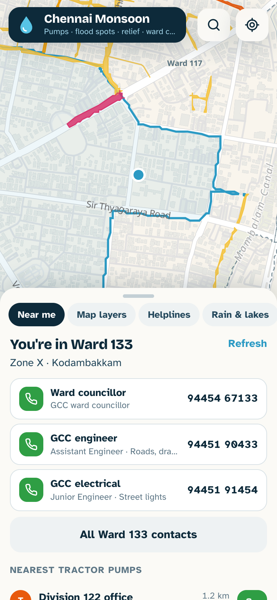
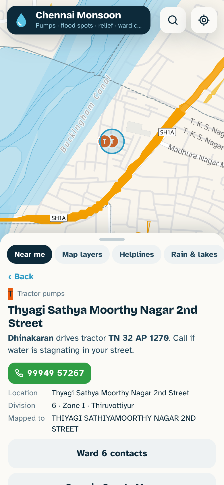

# Chennai Monsoon Map

**Live: <https://maps.reclaimchennai.city/monsoon/>**

GCC has put tractor pumps and diesel pumps out across Chennai for the north-east monsoon. This map puts them in one place with:

- the driver's phone number for every tractor pump;
- the streets that flooded in past monsoons;
- subways, relief centres, assembly points, NDRF teams and rescue boats;
- the officers for every one of the 200 wards.

On a phone, every number is a tap-to-call button. **Locate me** finds your ward and lists the nearest pumps, relief centres and officers. Everything also exports to KML, so the layers can be loaded into a Google My Maps map and opened in the Google Maps app.



| Phone: near me | Phone: a tractor pump |
|---|---|
|  |  |

Everything here is rebuilt from the source PDFs and screenshots by the scripts in `pipeline/`. Nothing is typed in by hand except the corrections listed in `pipeline/tractor_list.py` and `pipeline/diesel_list.py`.

---

## What is in it

| Layer | Items | Source |
|---|---|---|
| Tractor pumps (driver, mobile, tractor no.) | 463 rows (389 of 463 placed) | GCC "Line list of tractor pump" (screenshots in `raw/pump_lists/`) |
| Diesel / RP pumps | 151 (122 of 151 placed) | GCC list of pumps placed in 151 flood-prone spots |
| Flood-prone streets | 1,996 streets (1,301 of 1,996 placed) | CDMP: year-wise inundation tables 2015–2025, plus each zone's heavy-rain and stagnation tables |
| Relief centres, with officers' numbers | 132 of 198 placed | CDMP zone chapters |
| Evacuation and water-entered-houses streets | 336 of 377 placed | CDMP zone chapters |
| Subways | 28 of 54 placed | CDMP |
| Assembly points and parks | 318 of 552 placed | CDMP §5.1.4 plus the zone park lists |
| NDRF teams and rescue boats | 103 of 139 placed | CDMP zone chapters |
| Tree-fall spots | 128 of 139 placed | CDMP zone chapters |
| Ward officers (councillor, engineer, health, Metrowater, TANGEDCO, police, fire…) | 200 wards | CDMP ward-committee tables |
| Storm water drains | 5,513 conduits | [chennai-swd](https://github.com/reclaimchennai/chennai-swd) |
| Lakes, tanks and rivers | | TNGIS + OSM (maps-site `old/data`) |

CDMP = Greater Chennai Corporation, *City Disaster Management Plan*. The map uses the **2026** edition (800 pages). The **2024** edition is processed by the same script, as a check and for comparison.

## How exact are the locations?

The lists give a street or a building name, never coordinates. `pipeline/gazetteer.py` looks each one up **inside its own ward** (plus 250 m), in this order:

1. **TNGIS**, the Government of Tamil Nadu GIS, which has:
   - every GCC street as a polygon, with GCC's own name and ward;
   - GCC ward and zone offices;
   - GCC parks, playgrounds and community halls;
   - every school by name (the "CPS / CMS / CHSS…" corporation schools too);
   - police-mapped landmarks and health facilities.
2. **OpenStreetMap**: named streets, places and points of interest.

A match must share a distinctive word with the printed name, and agree on any street number. So "4th Cross Street" never lands on "2nd Cross Street", and a bare "Chennai Primary School" matches nothing. Each item is tagged with what it matched:

| Precision | Meaning | On the map |
|---|---|---|
| `street` | on the named GCC / OSM street (flood-prone streets are drawn as the street itself) | filled marker / coloured street |
| `place` | the named school, hall, park or landmark | filled marker |
| `office` | "Division office": the ward office in TNGIS (or the nearest one in the zone, labelled as such) | filled marker |
| `locality` | only the neighbourhood was found: the centre of that neighbourhood | hollow ring |
| `unplaced` | nothing matched | **not drawn**: listed under its ward and in search |

Nothing is ever dropped at a guessed spot. Of 4,069 items, 2,857 (70%) are on the map; every placement, with the source of the match, is in [`data/review/placements.csv`](data/review/placements.csv).

## Reproduce it

```bash
git clone https://github.com/reclaimchennai/chennai-monsoon-map && cd chennai-monsoon-map
python3 -m venv .venv && . .venv/bin/activate && pip install -r requirements.txt
make            # fetch PDFs (release assets, checksummed) + TNGIS layers, extract, place, export KML
```

The steps one by one:

```bash
pipeline/fetch_sources.sh                               # raw/cdmp/*.pdf (SHA256SUMS), raw/swd/network.json
python pipeline/fetch_tngis.py                          # raw/tngis/*.geojson.gz  (public TNGIS WFS)
pipeline/fetch_osm.sh                                   # optional: raw/osm/*.geojson.gz (committed already; needs GDAL)
python pipeline/cdmp_extract.py raw/cdmp/cdmp_2026.pdf --out data/cdmp/2026
python pipeline/build_layers.py --cdmp data/cdmp/2026   # data/layers/*.geojson, data/review/placements.csv
python pipeline/export_kml.py                           # data/kml/*.kml
web/deploy.sh                                           # copy web/ + data into the maps-site checkout and rsync it
```

The pump lists came as screenshots. `make pumps` re-runs their OCR, which needs `tesseract` and OpenCV. The checked CSVs are already in `data/pump_lists/`.

### A new edition of the CDMP

```bash
python pipeline/cdmp_extract.py raw/cdmp/cdmp_2027.pdf --out data/cdmp/2027
cat data/cdmp/2027/audit.json        # phones not extracted, unclassified tables
python pipeline/build_layers.py --cdmp data/cdmp/2027
```

`cdmp_extract.py` is not tied to page numbers:
- **Zones and printed page numbers** come from each page's running footer ("Zone - 7  452"). The zone is carried across map pages that have no footer.
- **Sections** come from the 16 pt headings.
- **Each table's kind** comes from its own column headers, its caption and the zone chapter's section heading. The rules are in the `RULES` list, which is easy to extend.

Run on the 2024 and 2026 editions, which differ in page offsets and in several tables' layout, the same code gives:

| | 2024 | 2026 |
|---|---|---|
| pages | 806 | 800 |
| tables (multi-page tables merged) | 896 | 745 |
| table rows | 11,705 | 11,073 |
| distinct phone numbers printed in the PDF | 2,321 | 2,417 |
| … of which not in the output | 4 (three landlines in an appendix table, one PIN code) | 1 (a PIN code next to a number, not a phone) |

## Extraction details

`cdmp_extract.py`, for every page:

- **Tables** are found from the ruling lines (pdfplumber), and their cells read in reading order:
  - Vertical column headers on landscape tables (rotated 90°) are read bottom to top.
  - Multi-page tables are merged when the next page starts with data rows, or repeats the header. Columns are matched by x-position if the count changes.
  - Rows printed without horizontal rules, where one cell holds `1\n2\n3…`, are split back into rows using the serial numbers' text lines.
  - Framed one-line titles become the caption of the table below them.
- **Map legends** and photo labels are tagged `map_legend` / `figure_label`, so they stay out of the datasets.
- **Phone numbers printed outside tables**, such as the "Ward councillor – 98…" line above each ward committee, are kept in `text_phones.csv`.
- **The audit** compares every phone number printed on each page with the output.

`cdmp_datasets.py` turns the classified tables into one CSV per kind:
- Columns are found by header words, because every zone office worded its tables differently.
- Rows a merged cell split in two are re-joined.
- Every row keeps `pdf_page` and `table_id`.

| `data/cdmp/<edition>/` | |
|---|---|
| `tables.jsonl`, `tables/NNNN_p<page>_<kind>.csv` | every table, in document order |
| `pages.csv` | printed page, zone and section for each PDF page |
| `datasets/inundation_history.csv` | year, zone, ward, location, depth class (>5 ft / 3–5 / 2–3 / <2) |
| `datasets/inundation_streets.csv`, `water_stagnation.csv` | zone tables: street, depth, drain time, pump, disposal point, rain intensity |
| `datasets/relief_centres.csv` | capacity, streets to shift, facilities, officers + numbers (JSON) |
| `datasets/ward_contacts.csv`, `ward_councillors.csv` | every ward's department officers |
| `datasets/officials.csv` | every other contact table, flattened |
| `datasets/subways.csv`, `evacuation_streets.csv`, `tree_fall.csv`, `ndrf.csv`, `boats.csv`, `parks.csv`, `assembly_points.csv`, `pumping_stations.csv`, `water_bodies.csv`, `storm_water_drains.csv`, `tenements.csv`, `narrow_lanes.csv`, `vehicles.csv`, `population.csv` | |
| `audit.json` | counts, phones not extracted, unclassified tables |

## Known gaps

- **Tractor list rows 187–233 are missing:** that page was not among the screenshots received.
- **Numbers that are invalid as printed** (9 or 11 digits) are shown greyed out, not as call buttons. The CDMP has some, for example the Zone 7 Zonal Officer's 11-digit number. Some rows also repeat another officer's number. They are kept as printed.
- **The CDMP's own counts often disagree with its tables**, for example the number of relief centres in a zone's intro text. The data follows the tables.
- **About 30% of items could not be placed:** mostly colony and nagar names that neither TNGIS nor OSM has. They are still listed under their ward.

## Layout

```
raw/        cdmp/ (PDFs via release, SHA256SUMS)  pump_lists/ (screenshots)  tngis/  osm/  swd/
pipeline/   cdmp_extract.py  cdmp_datasets.py  gazetteer.py  build_layers.py  export_kml.py
            ocr_tables.py  ocr_phone_check.py  tractor_list.py  diesel_list.py
            fetch_sources.sh  fetch_tngis.py  fetch_osm.sh
data/       cdmp/<edition>/  pump_lists/  layers/  kml/  review/
web/        index.html  app.js  deploy.sh          (static; MapLibre GL + OpenFreeMap)
docs/       screenshots/
```

## Sources and licences

| Source | Used for | Terms |
|---|---|---|
| Greater Chennai Corporation, *City Disaster Management Plan* 2026 and 2024 | flood history, zone tables, contacts | public document. The PDFs are mirrored as release assets; `raw/cdmp/SHA256SUMS` |
| GCC lists of tractor pumps and diesel/RP pumps (Oct 2026) | pumps, drivers' numbers | public lists, shared for residents to call |
| TNGIS, Government of Tamil Nadu (`tngis.tn.gov.in` WFS) | wards, streets, offices, schools, parks, landmarks | public WFS |
| © OpenStreetMap contributors | streets, places; basemap via OpenFreeMap | ODbL |
| [reclaimchennai/chennai-swd](https://github.com/reclaimchennai/chennai-swd) | storm water drains | CC BY 4.0 |
| osm-in/flood-map | December 2015 flooded streets | ODbL |

Code: MIT. Derived data: CC BY 4.0, credit "@reclaimchennai, from GCC and TNGIS data". Phone numbers are as published by GCC. If a number is wrong, open an issue so it can be fixed for everyone.
